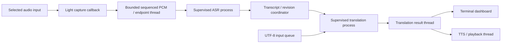

# Live runtime repair — November 7, 2026

The reported launch was `source .venv/bin/activate` followed by
`python tts-transcribe.py`. The direct entry point previously differed from the
new profile launcher: it could select an installed Gemma backend without weights
and an older translation model. It also warmed ASR synchronously before opening
capture, sent typed text directly to a blocking process queue, and did not
supervise translation initialization or child death. These are newly corrected
behaviors, not recovered October code.

## Processing boundaries



`tts_runtime/worker.py` owns process startup, bounded parent mailboxes, IPC,
readiness, fatal initialization/inference errors, child-death detection and
timeouts. Submission never serializes PCM, waits for IPC or calls a model in the
capture/keyboard caller. One request is active per model process. Committed jobs
are FIFO; speculative jobs coalesce by utterance key and can be evicted first.
Committed-capacity exhaustion explicitly rejects new work. Result-delivery
callbacks are separate from the IPC/watchdog controller. Completed translations
are preserved even when the result queue is full; only previews can be replaced.

`optional_dependencies.py` defers Torch, Transformers, Faster Whisper and Kokoro
imports until their selected backend actually needs them. A configuration-only
import loads none of the heavy model libraries. ASR and MT load/warm up in their
own processes, on the same thread used for their inference. Capture is already
independent of those processes, and initialization errors remain visible.

The main script keeps its language routing, endpointing and terminal behavior.
Its direct defaults now match the downloaded baseline: local Whisper Large v3
Turbo, local TranslateGemma 12B 4-bit, SoundDevice and ring capture. An installed
optional package alone no longer selects Gemma audio. Explicit model/backend
flags still win. Offline loading does not silently download/fall back to another
model. The narrow PyTorch macOS redirect notice is informational and filtered;
real exceptions are retained in worker diagnostics.

## Keyboard and playback repairs

A real PTY reproduced a second failure: pasting `hello world` plus Enter left
only `h` processed. `sys.stdin.read(1)` prefetched the rest into TextIO, while
`select()` then waited on an empty operating-system descriptor. The new reader
uses `os.read`, an incremental UTF-8 decoder, and a character deque drained
before another select call. Hebrew/Arabic mixed text and Enter now drain in one
paste, including UTF-8 characters split across byte reads. A rejected typed job
remains in the edit buffer; it is not cleared just because Enter was pressed.

Full-duplex TTS neither resets active capture nor applies the half-duplex
playback/energy duck. Speech rendering does not count as playback. Explicit
`--no-duplex-capture` retains playback/tail suppression. Voices are selected for
the spoken language, preserve multiword macOS voice names and never silently
substitute Turkish for Hebrew or another language. Empty synthesis output and
playback command failures are errors rather than apparent success.

## Operation and limits

Use `python tts-transcribe.py --list-devices`, then select the input that actually
receives audio. For example:

```sh
python tts-transcribe.py --input-device 'LitLink Audio Bridge' --source-language AR --target-language HE
```

The CAPTURE row reports incoming duration, level, speech/silence and loss. No
input for two seconds produces a routing/permission prompt instead of looking
like an idle model. ASR and TRANSLATION rows persist their loading, readiness,
busy/failure state and queue depth. Full errors are written locally to
`runtime-reports/pipeline-events.jsonl`; library output goes to the corresponding
`asr-worker.log` or `translation-worker.log`.

Default workers allow 180 seconds for startup, 120 seconds per request and 16
pending requests (`--startup-timeout`, `--inference-timeout`,
`--inference-queue-size`). Live capture ingress holds two seconds of frames.
These are bounded queues, not a guarantee that any model can keep up with any
audio rate. Capture continues independently under inference load; replaced
previews, explicit new-job rejection and reported capture gaps make overload
visible. Accepted committed work is not evicted. Immediate Escape/Ctrl-C exit
cancels unfinished work; flush and wait for final output before exiting when
the last utterance must be retained.

Only one selected audio source is supported per process. Full-duplex capture
does not itself cancel acoustic speaker echo; headphones or an appropriate
loopback route may be needed. The native bridge playback-completion timing
limitation remains documented separately.

## Validation scope

Final `make check` includes 35 embedded pipeline checks, 78 unit/integration
tests, and the native audio protocol checks. The new integration tests include
real PCM capture/endpoint processing while fake models stay loading, reverse
language routing, failed-stage behavior, and completed-result backpressure.
Eleven worker tests use actual spawned processes. Dependency and diff checks
also pass. No model package upgrades were needed for this refactor.

Real spawned-process tests exercise blocked startup, crashed initialization,
native-style child exit, stalled inference, queue saturation, committed FIFO,
partial coalescing, stale in-flight previews, blocked callbacks, serialization
failures and bounded shutdown. Pipe tests use real UTF-8 bytes and OS descriptors
to cover paste/Enter, split multibyte characters and EOF. Output queue pressure
tests check immediate rejection, atomic optional replacement and exactly-once
accepted work. Existing endpoint and native-protocol checks remain in place.

The ASR watchdog also submits fallback finals without waiting on its own result
queue. A full batch is retried after queued work is consumed, preventing a
consumer from blocking itself. Partial-result eviction changes the queue
atomically, without draining/reinserting committed results.

A real managed-session PTY test confirms the application accepts a complete
mixed Hebrew/Arabic paste, detects the unavailable Metal worker, retains rejected
input, and processes two Escapes to exit with code 0. It does not claim translation
inference passed. This Codex execution environment still exposes no Metal GPU or
CoreAudio devices. Actual transcription accuracy, translation quality, speech
playback and sustained hardware latency require a normal local Terminal run.
